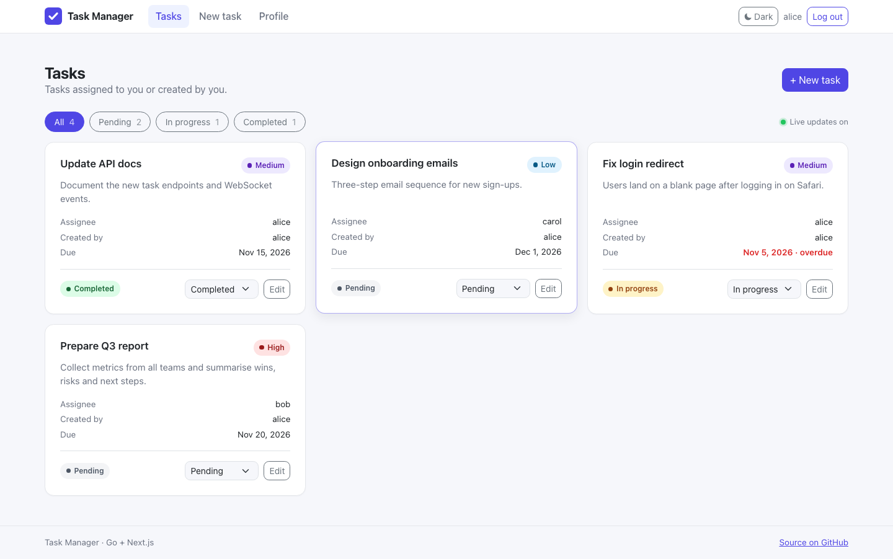
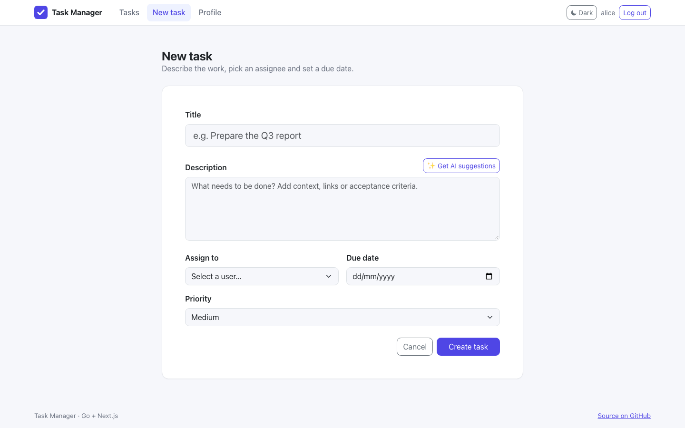
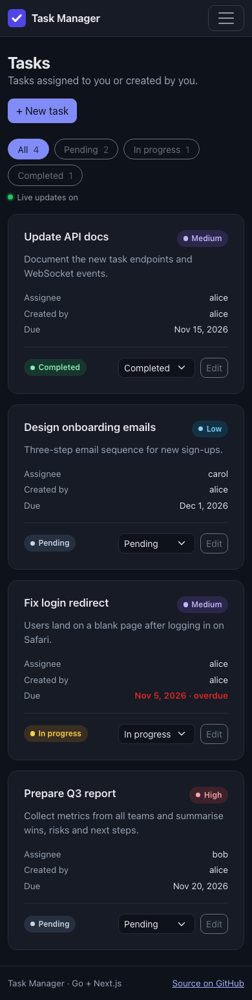

# AI-Powered Task Management System

A full-stack task manager with a Go (Gin) API, a Next.js frontend, JWT authentication, WebSocket updates and Google Gemini task suggestions.




## Overview

Users register and log in, create tasks and assign them to other users, and move tasks through `PENDING`, `IN_PROGRESS` and `COMPLETED`. While writing a task, a user can ask Google Gemini to improve the description and break it into subtasks. Task changes are pushed over an authenticated WebSocket, so open task lists refresh without reloading the page. Admins can see every task, delete tasks and list users.

## Features

- **Authentication**: register/login with bcrypt-hashed passwords and 24-hour HS256 JWTs signed with `JWT_SECRET`. Every request re-reads the user's role from the database, so promoting or demoting a user takes effect immediately.
- **Roles**: everyone registers as `user`. Admins are created with a small CLI (`go run ./cmd/promote -username <name>`), never through the public API.
- **Tasks**: title, description, assignee (picked from a user list), due date and priority (`LOW`/`MEDIUM`/`HIGH`). Users see tasks assigned to them or created by them; admins see all tasks.
- **Permissions**: the assignee, the creator or an admin can change a task's status; only the creator or an admin can edit or reassign it; only admins can delete.
- **AI suggestions**: `POST /api/tasks/suggestions` sends the description to Gemini (default model `gemini-2.5-flash`) and returns 2-3 suggestions plus 3-4 subtasks, which can be appended to the description with one click. The feature is switched off cleanly when `GEMINI_KEY` is not set.
- **Real-time refresh**: `/ws` broadcasts `{ "type": "task_updated", "taskId": 1 }`-style events on create/update/delete. Connections need a valid JWT and an allowed origin; the frontend reconnects with backoff and shows a "Live updates" indicator.
- **Frontend**: Next.js App Router with Bootstrap 5: landing page, login and sign-up, task board with status filters and counts, create/edit forms, profile, light/dark mode (remembered, no flash), mobile navigation, and loading, empty and error states.
- **Auto-migrations**: GORM creates the `users`, `tasks`, `task_tags` and `task_task_tags` tables on startup.

<p>
  
  
</p>

## Tech stack

| Layer | Technologies |
|-------|--------------|
| Backend | Go 1.26, Gin 1.12, GORM + PostgreSQL driver, golang-jwt/jwt v5, gorilla/websocket, gin-contrib/cors, godotenv, `golang.org/x/crypto/bcrypt` |
| AI | Google Gemini `generateContent` REST API (plain `net/http`, no SDK) |
| Frontend | Next.js 15 (App Router), React 19, TypeScript, Axios, Bootstrap 5 (npm package, no CDN) |
| Tests | `go test` with an in-memory SQLite database (`github.com/glebarez/sqlite`, pure Go) |

## Project structure

```
task-management/
├── backend/
│   ├── cmd/
│   │   ├── server/main.go        # API entry point
│   │   └── promote/main.go       # CLI: make a user admin (or demote)
│   ├── internal/
│   │   ├── auth/                 # JWT generation and verification
│   │   ├── config/               # .env / environment loading and validation
│   │   ├── database/             # GORM connection + auto-migrations
│   │   ├── handlers/             # task.go, user.go
│   │   ├── middleware/           # JWT auth, admin role check
│   │   ├── models/               # User, Task, TaskTag
│   │   ├── routes/               # Gin router, CORS, route tests
│   │   └── websocket/            # Authenticated broadcast hub
│   ├── pkg/ai/                   # Gemini client
│   ├── .env.example
│   └── Dockerfile
└── frontend/
    ├── .env.example
    └── app/
        ├── lib/                  # api.ts (Axios client + session), types.ts
        ├── components/           # Navbar, AuthForm, TaskForm, TaskList, UserProfile, RequireAuth
        ├── hooks/                # useSession, useWebSocket
        ├── login/ register/ signup/ profile/
        └── tasks/                # list, new, edit/[id]
```

## Getting started

### Prerequisites

- Go 1.26+
- Node.js 18.18+ and npm
- PostgreSQL
- Optional: a Google Gemini API key ([Google AI Studio](https://aistudio.google.com/))

### Backend

```bash
git clone https://github.com/VamsiKrishnaThota03/task-management.git
cd task-management/backend
cp .env.example .env      # then fill in the values
go run ./cmd/server       # http://localhost:8080
go test ./...             # optional: run the tests (no database needed)
```

The server refuses to start without `DB_URI` and a `JWT_SECRET` of at least 32 characters.

| Variable | Required | Description | Default / example |
|----------|----------|-------------|-------------------|
| `DB_URI` | yes | PostgreSQL connection string | `postgres://<user>:<password>@localhost:5432/<db>?sslmode=disable` |
| `JWT_SECRET` | yes | HMAC key for JWTs, 32+ characters (`openssl rand -hex 32`) | |
| `GEMINI_KEY` | no | Google Gemini API key. Without it, the suggestions endpoint returns `503` | |
| `GEMINI_MODEL` | no | Gemini model name | `gemini-2.5-flash` |
| `CORS_ORIGINS` | no | Comma-separated frontend origins allowed by CORS and the WebSocket | `http://localhost:3000` |
| `HOST` | no | Bind address | `127.0.0.1` (the Docker image sets `0.0.0.0`) |
| `PORT` | no | HTTP port | `8080` |

**Create an admin:** register normally, then run `go run ./cmd/promote -username <name>` from `backend/` (uses `DB_URI`). Use `-role user` to demote.

**Docker:**

```bash
cd backend
docker build -t task-api .
docker run --env-file .env -p 127.0.0.1:8080:8080 task-api
```

### Frontend

```bash
cd task-management/frontend
cp .env.example .env.local   # optional, defaults to http://localhost:8080
npm install
npm run dev                  # http://localhost:3000
```

| Variable | Description | Default |
|----------|-------------|---------|
| `NEXT_PUBLIC_API_URL` | Base URL of the Go API | `http://localhost:8080` |
| `NEXT_PUBLIC_WS_URL` | WebSocket URL | API URL with `ws(s)://` and `/ws` |

| Script | Description |
|--------|-------------|
| `npm run dev` | Start the Next.js dev server |
| `npm run build` | Production build (includes type checking) |
| `npm start` | Serve the production build |
| `npm run typecheck` | `tsc --noEmit` |

## API

| Method | Path | Auth | Purpose |
|--------|------|------|---------|
| `POST` | `/register` | none | Create a user (`username` 3-32 chars, `password` 8-72 chars). Always role `user`; `409` if taken |
| `POST` | `/login` | none | Returns `{ token, role, user }` |
| `GET` | `/health` | none | Health check |
| `GET` | `/ws?token=<jwt>` | JWT (query) | WebSocket; receives task change events |
| `GET` | `/api/profile` | JWT | Current user's profile |
| `GET` | `/api/users/assignable` | JWT | `id` and `username` of all users, for the assignee picker |
| `GET` | `/api/tasks` | JWT | Tasks assigned to or created by the user (all for admins); optional `?status=` |
| `POST` | `/api/tasks` | JWT | Create a task (`title`, `description`, `assignedTo`, `dueDate` as `YYYY-MM-DD`, `priority`) |
| `GET` | `/api/tasks/:id` | JWT | One task (404 if you cannot see it) |
| `PUT` | `/api/tasks/:id` | JWT (creator/admin) | Edit any of `title`, `description`, `assignedTo`, `dueDate`, `priority`, `status` |
| `PUT` | `/api/tasks/:id/status` | JWT (assignee/creator/admin) | Update status (`PENDING`, `IN_PROGRESS`, `COMPLETED`) |
| `POST` | `/api/tasks/suggestions` | JWT | Gemini suggestions for a `description` |
| `DELETE` | `/api/tasks/:id` | admin | Delete a task |
| `GET` | `/api/users` | admin | List users with roles |

Send protected requests with `Authorization: Bearer <token>`. Task JSON uses camelCase keys (`id`, `title`, `status`, `assignedToName`, ...).

## Known limitations

- The JWT is stored in `localStorage` and passed to the WebSocket as a query parameter (browsers cannot set headers on WebSocket requests). The backend keeps `/ws` out of its access log, but proxies in front of it may log query strings.
- There is no logout on the server side: tokens stay valid until they expire (24 hours), although deleted users are rejected immediately.
- Tags exist in the database schema but have no API or UI yet.
- No rate limiting on `/login` and `/register`; put the API behind a proxy that rate limits if it is public.
- `npm audit` still reports a PostCSS advisory inside Next.js 15's bundled copy; it is fixed only in Next.js 16 (major upgrade not done).

## Future enhancements

- Docker / Kubernetes deployment
- Slack or Discord notifications for task updates
- AI-assisted task prioritisation

## Contact

Thota Vamsi Krishna — [GitHub](https://github.com/VamsiKrishnaThota03)
